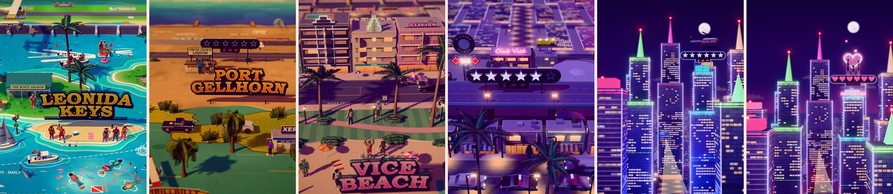

# Miami Popup Game Map

A papercraft pop-up map of Leonida, the state from GTA VI, made entirely in code.

The video is a single 57-second camera move. It starts in Leonida Keys, passes through Grassrivers, Port Gellhorn and Vice Beach, and ends at night in Vice City. Cards stand up as the camera reaches them, and the light goes from day to night. Nothing was modeled in a 3D tool or drawn by hand. Geometry, print art, camera and timing are all code, plus one generated image sheet for the tourists in the opening.



This repository contains:

| Folder | What's in it |
|---|---|
| [`skills/popup-map/`](skills/popup-map/) | A Claude Code skill: the method, step by step, with the rules and lessons that cost us a round each |
| [`example/`](example/) | The full working project that renders the Leonida video: three.js engine, capture pipeline, the scene, tests |
| [`making-of/`](making-of/) | How it got there: every round side by side, the generated image sheets with both prompts and the review, blind A/B pairs, switch tables |

## Use the skill

Copy `skills/popup-map/` into your skills folder (`~/.claude/skills/popup-map/` for Claude Code), then ask for a map:

> Make a pop-up paper map video of *your city or game world*, about 45 seconds, cut to *your track*.

The skill walks through the work in order: brief, art rules, route, one dense region, props, motion, look, automatic checks, review, export. It uses `example/` as the engine, so keep the repository around or clone it when the skill asks.

## Render the Leonida example

Tested on Windows 11 with an NVIDIA RTX 4070 and Google Chrome. macOS and Linux should work but have not been tried.

You need Google Chrome, Node.js, Python 3.12, ffmpeg on `PATH`, and a hardware GPU (software WebGL is refused).

```powershell
cd example
npm --prefix web ci
python -m venv .venv
.\.venv\Scripts\python.exe -m pip install -r requirements.txt
.\.venv\Scripts\python.exe -m popup.pipeline.web_textures

# a few stills first (seconds)
.\.venv\Scripts\python.exe -m popup.pipeline.web_stills --scene scenes/leonida/index.js --style styles/leonida.js:Sunset --preset final --times 3,30,56.5 --out out/stills

# the whole film: 1714 frames, about 6 minutes on an RTX 4070
.\.venv\Scripts\python.exe -m popup.pipeline.web_render --scene scenes/leonida/index.js --style styles/leonida.js:Sunset --t0 0 --t1 1714/30 --preset final --parallel 2 --out out/leonida.mp4
```

The music is not included. The cut follows M83's "Midnight City" (105 BPM). See [render.md](skills/popup-map/references/render.md) for adding your own audio.

More commands, including tests, the clip-through audit and contact sheets, are in [example/README.md](example/README.md).

## How it was made

- **Claude Code (Claude Opus 5.5)** wrote the map: regions, print art, props, camera, timing, style. It also wrote the task briefs for Codex.
- **Codex** built the rendering base from those briefs: the three.js paper primitives, the pop-up book mechanisms, the post-processing chain, and the headless-Chrome capture and encode pipeline. It also generated the tourist image sheet in the opening.
- **A second Claude** reviewed the work: it checked the generated sheets against two style gates and judged old and new versions in blind pairs.
- **The author** set the direction, rejected what didn't work, and chose between versions.

It took two days and about 14 hours of active work. On a Claude Max 5x plan that was roughly 15 % of a week's usage. That is a rough estimate, because other projects ran the same week.

The first version was rejected outright: "nothing to do with GTA6; neither artistic nor realistic". The final one is version 13 plus 18 fix batches. See [making-of/](making-of/).

Numbers for the final cut:

- 1080×1440 at 30 fps, 1714 frames, rendered at 2× and downsampled.
- About 640 props pop up.
- The clip-through audit samples every 0.1 s and found 0 overlaps over 573 instants.
- In blind review against the previous version, the new one won 6 of 14 pairs, tied 8 and lost 0.

## Fan work

This is a non-commercial fan project. Grand Theft Auto, GTA VI, Leonida, Vice City and related names are trademarks of Take-Two Interactive / Rockstar Games. Neither company made or endorses this project.

- No official images are included. Official art and screenshots were used only as references: colors were measured from them and they were never printed on a card.
- No official character faces and no game or publisher logos. The protagonists appear masked or from behind, and there are no guns.
- In-world place names and shop signs are printed on the map, as fan work.

## License

[MIT](LICENSE) © 2026 MoyGoldenAge. This covers the code, the documents and the images in this repository. It doesn't cover the trademarks above.
