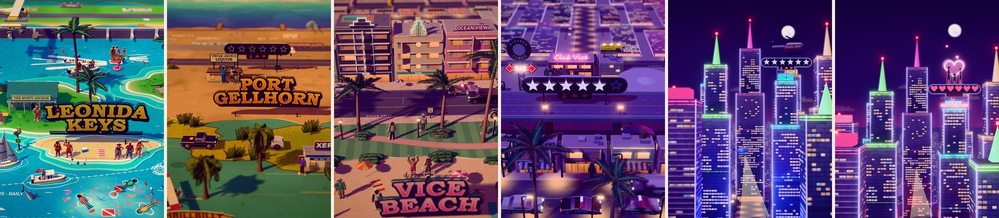
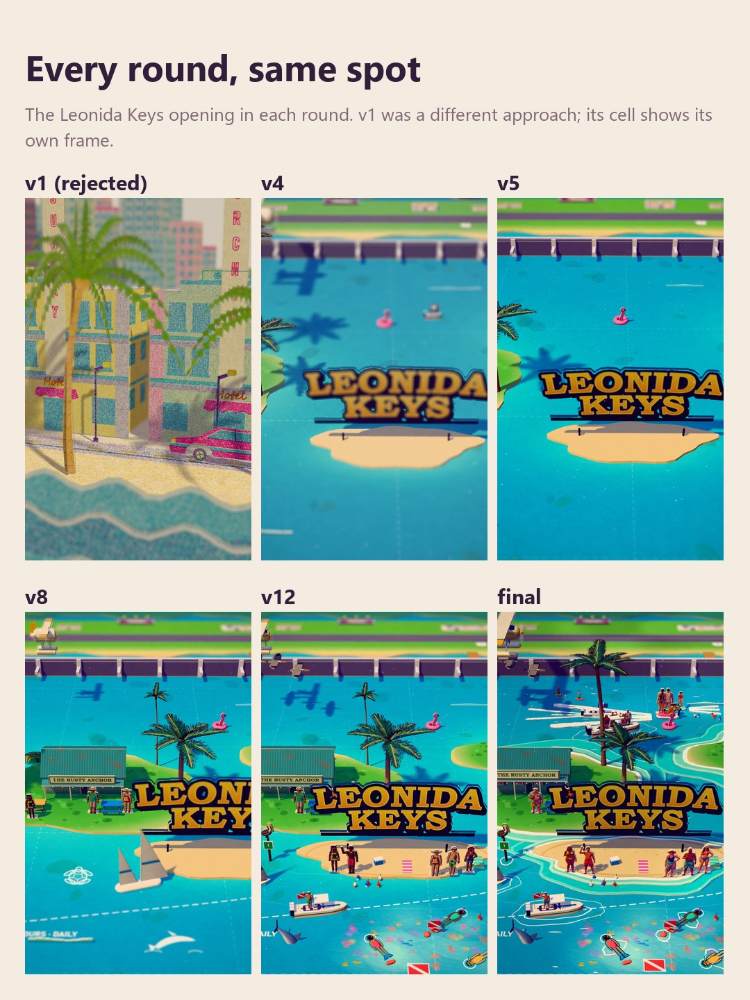
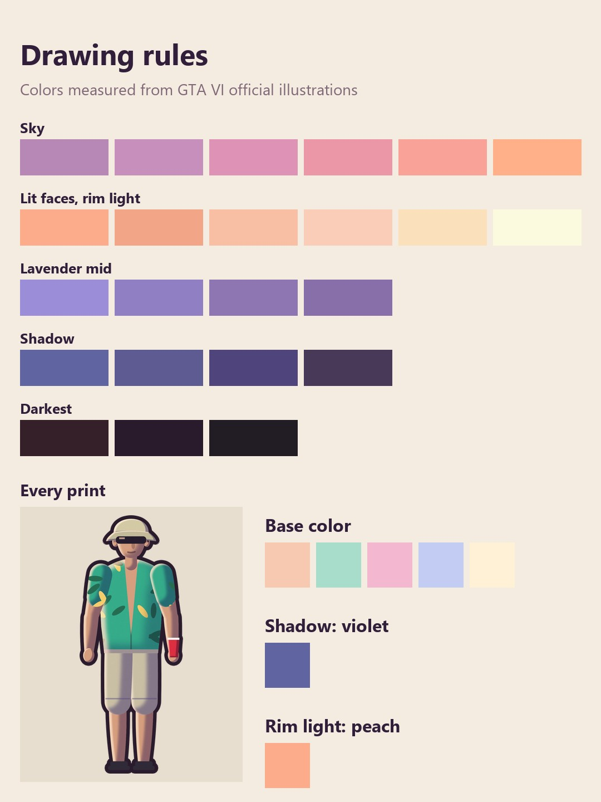
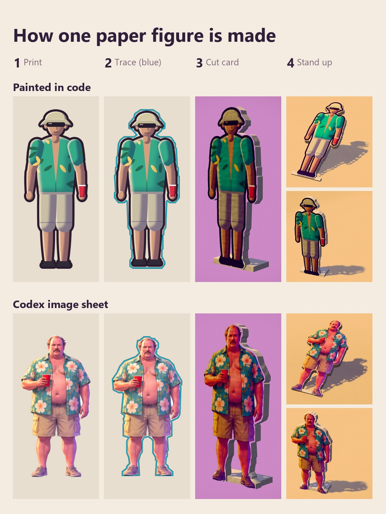
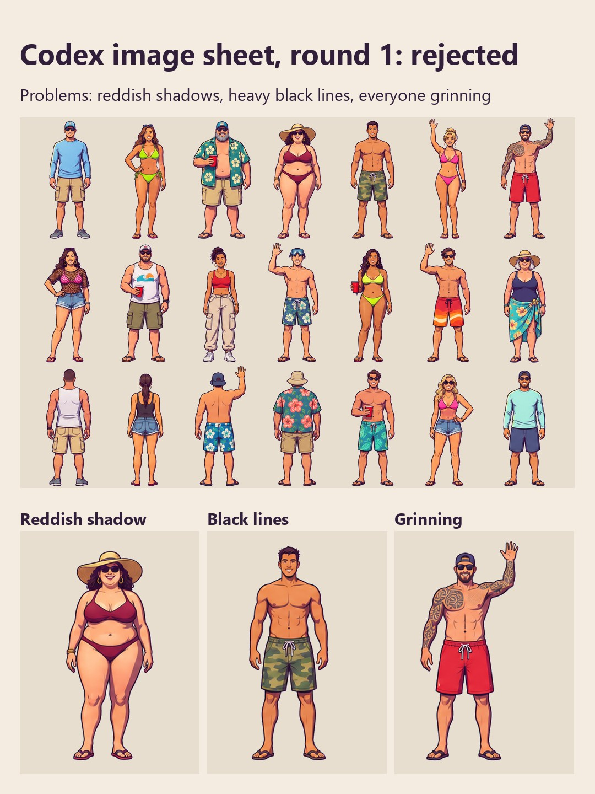
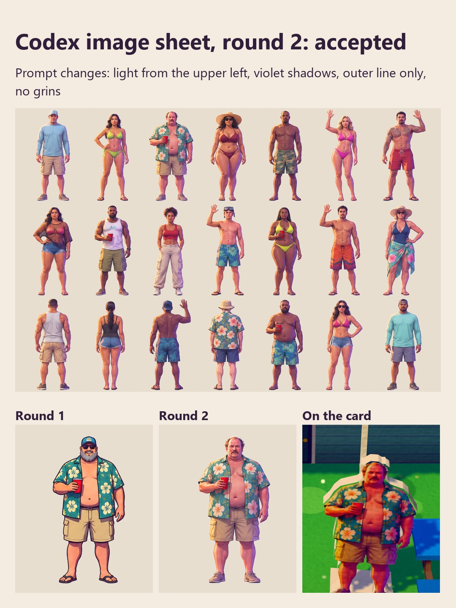
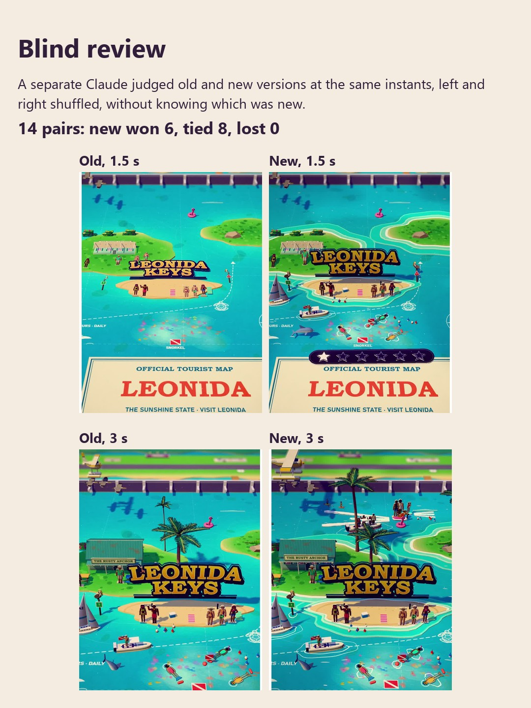

# Making of

How the Leonida map got from a rejected first round to the final cut.

## Every round, same spot

Round 1 ([round1.jpg](round1.jpg)) was a different approach: a pop-up book on a desk, boxes with window grids, a fast flying camera. The verdict was "nothing to do with GTA6; neither artistic nor realistic", and the work started over.

After that, the video became one camera move over a tabletop map of Leonida. Versions up to 13 built the route and filled it. Then 18 fix batches came out of review: denser openings, a generated tourist sheet, special-paper gloss at night, 2× supersampling, focus pulls, the ending.

## Drawing rules

The colors were measured from GTA VI's official illustrations, and each print is base color + violet shadow + peach rim light. The full rule set is in [print-art.md](../skills/popup-map/references/print-art.md).

## One paper figure, four steps

The same four steps apply to a figure painted in code (top row) and a figure cut from the Codex image sheet (bottom row): print, trace the alpha edge, extrude a card, stand it up.

## Codex image sheet: two rounds

The files are in [`codex-atlas/`](codex-atlas/):

| File | What |
|---|---|
| `round1_prompt.txt` | the round-1 prompt |
| `people_v1a.jpg`, `people_v1b.jpg` | round-1 sheets, both rejected. They looked like a summer-beach sticker pack: reddish-brown shadows, black ink on muscles and pockets, everyone grinning, one bright-orange skin tone |
| `round2_prompt.txt` | the round-2 prompt, with the light, line, expression and skin rules written out |
| `people_v2a.jpg` | round 2, same style, but feet cross the row lines on two rows, so it can't be cut on a fixed grid |
| `people_v2b.jpg` | round 2, accepted and used as is (also `example/web/assets/generated/keys_people.png`) |

Round 2 used one official-illustration crop as a lighting reference. Official images are not in this repository. The prompts are as sent, except one parenthetical in round 2 that was in Chinese and is translated here ("(cells 7, 9, 15)").

The review went through four gates, and the first two could each reject a sheet on their own:

1. Game style (veto): round 1 failed, round 2 passed.
2. Our film's style (veto): round 1 failed, round 2 passed.
3. Cuttable on the grid: `v2b` passed; `v2a` failed on rows 1–2.
4. Red lines (logos, weapons, official characters, text): every sheet passed.

How the sheet is cut onto cards is in [image-gen.md](../skills/popup-map/references/image-gen.md).

## Blind review

All 14 pairs are in [`blind-review/`](blind-review/). The old version was round 13 and the new one was after the first fix batches; left and right were shuffled. The reviewer saw only the images and decided which side looked better before knowing which was new. Result: new won 6, tied 8, lost 0.

| Pair | Time (s) | New version is on the | Reviewer's call |
|---|---|---|---|
| 01 | 0.3 | left | new: shallow-water paper layers, empty wanted stars on the title card |
| 02 | 1.5 | left | new: sailboat, dive boat, snorkelers, dolphin already up; first star lit |
| 03 | 3 | right | new: shallow layers, wake rings, paddle board, party boat |
| 04 | 5 | right | new: layered water instead of one flat cyan |
| 05 | 7 | left | new: paper shallows and wakes in the foreground |
| 06–11 | 10–30 | left, left, right, right, left, right | about the same (brightness or pop-up timing only) |
| 12 | 35 | left | new: in the old one, three cars pass through each other |
| 13–14 | 40, 46 | (night, indistinguishable) | about the same |

## Per-segment switches

[`switches/off-vs-final.jpg`](switches/off-vs-final.jpg) shows six instants with all four switches off (left) and as in the final cut (right). In a full frame the difference is small. That is the point: the switches were decided from close-ups and consecutive frames, not by asking someone to spot differences they can't see. How each switch was decided is in [review.md](../skills/popup-map/references/review.md). Rebuild the table with `tools/ab_table.py` (see [example/README.md](../example/README.md)).
